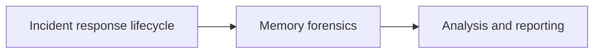

# IA 455 - Incident Response

College coursework archive for **IA 455 - Incident Response** at Eastern Michigan University.  
Labs, quizzes, memory forensics practical work, and course assessments.

**Author:** [Julio Barros](https://github.com/Jkbarros)  
**Index:** [college-projects](https://github.com/Jkbarros/college-projects)

## What is in this repository

| Area | Description |
|------|-------------|
| [`archive/canvas-submissions/`](archive/canvas-submissions/) | Labs, quizzes, midterm/final PDFs, memory forensics assignment, analysis logs |

### Highlights in the archive

- **Lab 1** and quizzes (chapters covered in course)
- **Assignment 2 - Memory Forensics Practical** (DOCX)
- **Midterm and final** exam PDFs
- **`full_analysis.log`** - supporting output from forensic analysis work
- **FINAL IA455** consolidated submission

## Topics covered

## Related repos

| Course | Link |
|--------|------|
| IA 103 - Information Security Overview | [information-security-overview](https://github.com/Jkbarros/information-security-overview) |
| COSC 381 - Software Engineering | [software-engineering-solutions](https://github.com/Jkbarros/software-engineering-solutions) |

## Roadmap

- [ ] Convert key labs to markdown in `docs/` (same pattern as IA 103)
- [ ] Redact any sensitive identifiers before expanding public docs

## Notes for readers

- This repo documents **my submitted work**; forensic artifacts are for academic context only.
- Do not treat course logs or reports as guidance for live incident handling without professional validation.

## License

Content © Julio Barros. Use at your own risk.
