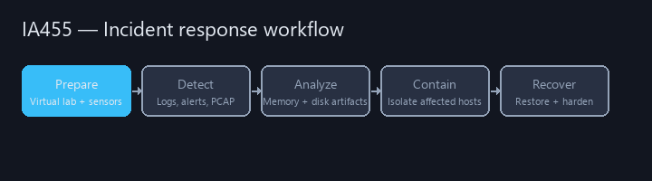
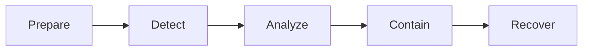

# IA 455 - Incident Response



College coursework portfolio for **IA 455** at Eastern Michigan University.  
**Virtual IR lab**, **memory forensics** (Volatility 2), quizzes, exams, and a **final capstone** tying malware indicators to logs and host triage.

**Author:** [Julio Barros](https://github.com/Jkbarros)  
**Index:** [college-projects](https://github.com/Jkbarros/college-projects)

## What is in this repository

| Area | Description |
|------|-------------|
| [Submissions catalog](docs/submissions-catalog.md) | Curated guides + archive conversions |
| [Lab 1 — virtual IR lab](docs/lab1-virtual-lab.md) | pfSense, Security Onion, Kali, Windows 10 |
| [Assignment 2 — memory forensics](docs/assignment-2-memory-forensics.md) | Volatility 2 plugin walkthrough |
| [Final capstone](docs/final-capstone.md) | Malware hashes, PowerShell, logs, PCAP |
| [Learning notes](docs/learning-notes.md) | Quiz concepts without copying prompts |
| [full_analysis.log excerpt](docs/full-analysis-log.md) | Volatility session capture |
| [Midterm](docs/ia455-midterm.md) · [Final exam](docs/ia455-final-exam.md) | PDF exports with screenshots |
| [Archive index](docs/archive-index.md) | All original Canvas files |

### Highlights

- Curated markdown labs (readable on GitHub) plus DOCX/PDF archive conversions
- Real `full_analysis.log` from memory-dump analysis in class

## Topics covered



## Regenerate docs

```bash
pip install -r requirements.txt
python scripts/docx_to_markdown.py
python scripts/build_pdf_docs.py
python scripts/build_analysis_log_doc.py
python scripts/generate_readme_demo.py
```

## Related repos

| Course | Link |
|--------|------|
| IA 447 - Digital Forensics I | [ia447-digital-forensics-i](https://github.com/Jkbarros/ia447-digital-forensics-i) |
| IA 103 - Information Security | [information-security-overview](https://github.com/Jkbarros/information-security-overview) |
| college-projects index | [college-projects](https://github.com/Jkbarros/college-projects) |

## Notes for readers

- Academic IR exercises only — not operational runbooks for production incidents.
- Forensic logs and malware indicators are **point-in-time** course artifacts.

## License

Content © Julio Barros. Use at your own risk.
