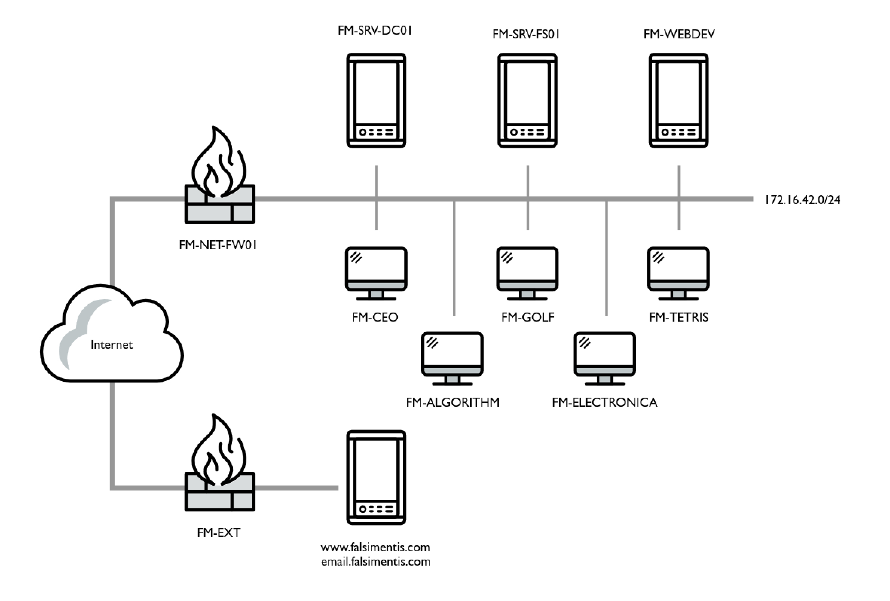

# ia455-final

**Source:** [`ia455-final.pdf`](../archive/canvas-submissions/ia455-final.pdf)  
**Course:** IA 455 - Incident Response (EMU)  
**Author:** Julio Barros

## Page 1

Eastern Michigan University
School of Information Security and Applied Computing
IA 455 Incident Response - Final Exam
Dec 6, 2024; Due: 11:59 PM Dec 9, 2024
Instructions
This paper contains 10 multiple choice questions and 4 other questions, and comprises 5
pages. Answer ALL questions. This is an open-book exam. Please only run the specimens
in virtual machines.
All attached files are available at Google Drive.
The marking scheme is shown in the left margin and [100] constitutes full marks.
1. (40 points) Multiple choice questions: read each question carefully and choose the
correct answer: A, B, C or D. Make sure you only choose one answer for each question.
(1) (4 points) During which of the following phases would you most likely acquire a
host forensic image?
A. Identification B. Eradication C. Preparation D. Containment
(2) (4 points) In the six stages of PICERL, the organization return to normal opera-
tions in which stage?
A. Preparation
B. Identification
C. Containment, Eradication, and Recovery
D. Lessons Learned
(3) (4 points) Which of the following activities would most likely be performed during
the eradication phase?
A. Backup restoration
B. Removal of compromised system files
C. Addition of a firewall rule that blocks communication to a system owned by the
attacker
D. Evaluation of the incident’s criticality
(4) (4 points) Which option will allow you to capture HTTP traffic originating from
172.16.197.135 and destined for a web server located at 172.16.197.136, listen-
ing on TCP port 8080?

## Page 2

A. tcpdump -ieth0 host 172.16.197.135 and host 172.16.197.136 and port
8080
B. tcpdump -ieth0 src host 172.16.197.135 and dst host 172.16.197.136
and port http
C. tcpdump -ieth0 src host 172.16.197.135 and dst host 172.16.197.136
and port 8080
D. tcpdump -ieth0 host 172.16.197.135 and host 172.16.197.136 and port
http
(5) (4 points) Review the following command output showing several SYN flags; which
of the following statements seems to be the most accurate?
08:37:30.960042 IP 172.16.197.135.13732 > 172.16.197.136.21: Flags [S], seg 411023881, win 512, length 0
08:37:30.960043 IP 172.16.197.135.13733 > 172.16.197.136.21: Flags [S], seq 1277798167, win 512, length 0
08:37:30.960044 IP 172.16.197.135.13734 > 172.16.197.136.21: Flags [S], seq 1508411056, win 512, length 0
08:37:30.960045 IP 172.16.197.135.13735 > 172.16.197.136.21: Flags [S], seq 1690259038, win 512, length 0
08:37:30.960048 IP 172.16.197.135.13736 > 172.16.197.136.21: Flags [S], seg 269512661, win 512, length 0
08:37:30.960049 IP 172.16.197.135.13737 > 172.16.197.136.21: Flags [S], seg 557401364, win 512, length 0
08:37:30.960109 IP 172.16.197.135.13738 > 172.16.197.136.21: Flags [S], seq 1863347054, win 512, length 0
08:37:30.960110 IP 172.16.197.135.13739 > 172.16.197.136.21: Flags [S], seq 1733851168, win 512, length 0
08:37:30.960112 IP 172.16.197.135.13740 > 172.16.197.136.21: Flags [S], seq 1522163958, win 512, length 0
08:37:30.960113 IP 172.16.197.135.13741 > 172.16.197.136.21: Flags [S], seg 1605482239, win 512, length 0
08:37:30.960114 IP 172.16.197.135.13742 > 172.16.197.136.21: Flags [S], seq 707356601, win 512, length 0
08:37:30.960115 IP 172.16.197.135.13743 > 172.16.197.136.21: Flags [S], seg 1358872722, win 512, length 0
08:37:30.960116 IP 172.16.197.135.13744 > 172.16.197.136.21: Flags [S], seq 76706733, win 512, length 0
08:37:30.960116 IP 172.16.197.135.13745 > 172.16.197.136.21: Flags [S], seg 1755229322, win 512, length 0
08:37:30.960117 IP 172.16.197.135.13746 > 172.16.197.136.21: Flags [S], seg 1777614931, win 512, length 0
08:37:30.960120 IP 172.16.197.135.13747 > 172.16.197.136.21: Flags [S], seq 684952947, win 512, length 0
A. There’s a DDoS attack in progress. B. There’s a DoS attack in progress.
C. Someone is running a port scan. D. Standard traffic.
(6) (4 points) Which of the following logs would you use to identify failed administrator
logins?
A. Application B. System C. Setup D. Security
(7) (4 points) Using the command cut -d: -f1 /etc/shadow will achieve which of
the following?
A. Provide a list of user groups
B. Provide a list of usernames
C. Remove the first column of the shadow file
D. Display the shadow file in an alphabetically sorted format
(8) (4 points) Which of the following PowerShell commands can return the command
line of a process with PID 4567?
Page 2

## Page 3

A.
Get-Process |
Where-Object ProcessId -eq 4567 |
Select-Object CommandLine
B.
Get-CimInstance -ClassName Win32 Process |
Where-Object ProcessId -eq 4567 |
Select-Object CommandLine
C.
Get-Process |
Where-Object Name -eq 4567 |
Select-Object CommandLine
D.
Get-CimInstance -ClassName Win32 Process |
Where-Object Name -eq 4567 |
Select-Object CommandLine
(9) (4 points) Which command was most likely to generate the following output listing
various local and remote ports in listening state?
A. Get-NetTCPConnection B. Get-Service
C. Get-ItemProperty D. Get-LocalGroup
(10) (4 points) Which of the following communication protocols would make Control
and Command traffic harder to detect?
A. FTP B. HTTP C. HTTPS D. ICMP
2. (15 points) Please generate both host-based and network-based Indicators of Compro-
mise (IoCs) using the provided specimen (q2.zip) with the password “malware”. Fill in
the following table with the IoCs you found.
IoC Name Details
File Hash (SHA256)
Loaded DLLs
Mutex
Hardcoded URL
User Agent
3. (15 points) Unzip the file “q3.zip” using the password “malware” into a new, clean
directory on your Windows VM. Next, execute the “setup.ps1” script in a PowerShell
Page 3

## Page 4

window with Administrator privileges. After completing these steps, please provide your
commands and screenshots as your response. If the script does not work on your Win-
dows VM, please download the ready-to-use VM “IA455WI24.ova.zip” (login password
is “vagrant”, unzip password is “IDhrXAvs5vG1”). You can find the scripts located at
“C:\ia455”.
(1) (3 points) Identify the processes that are currently running from temporary direc-
tories.
(2) (3 points) Determine the TCP ports being listened to by these processes.
(3) (3 points) Terminate one of these processes with a sha256sum of the process name
equal to ad4d1fb677c83801b208d21b819fe6c3c7670974f16e5fc52ba7245ac7119926
(Generated with an Online Tool with Input Type = UTF-8)
(4) (3 points) Remove any autoruns associated with the process you stopped in (c).
(5) (3 points) Using the “baseline/services.txt” file as a reference, identify the service
that was added after executing “setup.ps1”.
4. (15 points) A company with the provided network topology has reported a ransomware
incident on host 172.16.42.107. You are provided with
• q4-access.log: an access log file from Squid proxy, capturing all HTTP and
HTTPS requests on the standard ports from the network;
• q4.pcap: the packet capture file acquired from the firewall.
Use the given files to answer the following questions, and include your commands and
screen shots.
Page 4

## Page 5

IP Hostname Description
172.16.42.2 FM-SRV-DC01.falsimentis[.]com Domain controller
172.16.42.3 FM-SRV-FS01.falsimentis[.]com Corporate file server
172.16.42.10 FM-NET-FW01.falsimentis[.]com Network firewall and Squid server
172.16.42.20 FM-WEBDEV.falsimentis[.]com Internal web development server
172.16.42.103 FM-TETRIS.falsimentis[.]com System administrator’s workstation
172.16.42.105 FM-ELECTRONICA.falsimentis[.]com Web developer’s workstation
172.16.42.107 FM-CEO.falsimentis[.]com CEO’s workstation
172.16.42.108 FM-ALGORITHM.falsimentis[.]com V.P. of Operations’ workstation
172.16.42.109 FM-GOLF.falsimentis[.]com An engineer’s workstation
(1) (5 points) Using the access log file, identify the Control and Command server based
on the number of requests made to it.
(2) (10 points) Using both the access log and pcap file, identify other compromised
hosts and determine the first time each of them connected to the server.
5. (15 points) During the incident handling process mentioned in Q4, the Incident Re-
sponse (IR) analyst collected the memory image “q5.mem” from the CEO’s workstation.
Analyze the image using Volatility and answer the following questions by providing your
commands, detailed steps, and screen shots:
(1) (5 points) With the known IP address of the CnC server (167.172.201.123), identify
the process that was connecting to this server during the memory acquisition.
(2) (5 points) Determine the ancestors of the process identified in (1).
(3) (5 points) Find and provide the path to the executable file of the process identified
in (1).
END OF PAPER
Page 5
