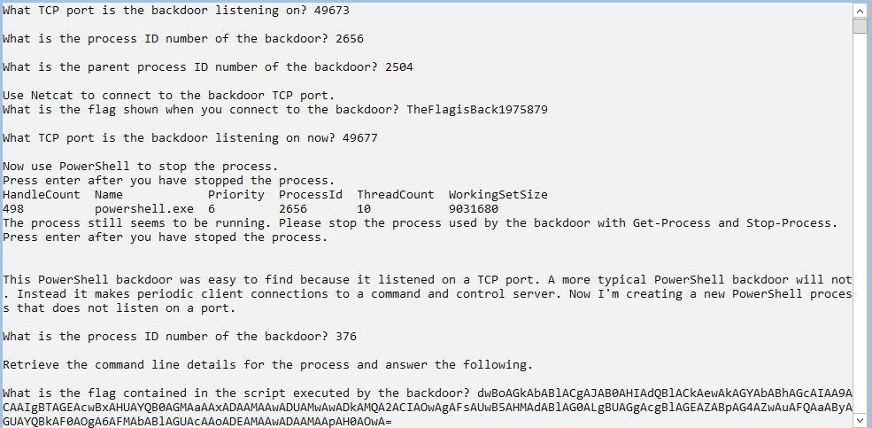
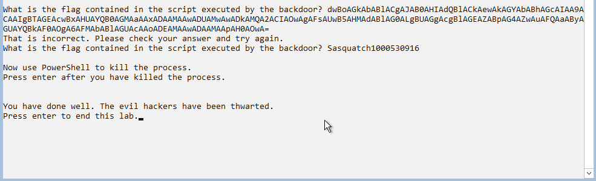

# ia455-midterm final

**Source:** [`ia455-midterm final.pdf`](../archive/canvas-submissions/ia455-midterm%20final.pdf)  
**Course:** IA 455 - Incident Response (EMU)  
**Author:** Julio Barros

## Page 1

Eastern Michigan University 
School of Information Security and Applied Computing 
IA 455 Incident Response - Midterm Exam 
Oct 17, 2023; Due: 11:59 pm Oct 20, 2023 
 
Instructions 
This paper contains 10 multiple choice questions and 3 other questions, and comprises 3 pages. 
This is an open-book examination. Run the malware samples in a virtual machine. The 
marking scheme is shown in the left margin and [100] constitutes full marks. 
 
[40] 1. Multiple choice questions: read each question carefully and choose the correct answer: A, B, C or D. 
Make sure you only choose one answer for each question. 
[4] (1) What step should always be taken first during an incident? 
A. Identifying which systems are unpatched 
B. Verifying whether an incident occurred 
C. Choosing which systems to rebuild 
D. Determining which threat intelligence feeds to query 
[4] (2) What are the phases of incident handling, in order, in the classic six -step incident response 
process?  
A. Preparation, containment, eradication, recovery, retaliation, and lessons learned 
B. Preparation, identification, recovery, encapsulation, eradication, and lessons learned 
C. Preparation, identification, containment, eradication, recovery, and prosecution 
D. Preparation, identification, containment, eradication, recovery, and lessons learned 
[4] (3) Which type of system is most used to investigate malware?  
A. Thick client 
B. Production system 
C. Virtual machine 
D. Day-to-day host 
[4] (4) If you believe your system has been the victim of a rootkit attack, what is the most cost -
effective form of eradication?  
A. Patch and reboot the compromised system 
B. Reformat, reinstall, and patch the system from the original media 
C. Restore the OS from the most recent backup 
D. Install applications from a different vendor 
[4] (5) What is the primary purpose of Differential Analysis in incident response?  
A. To determine the exact cause of an incident. 
B. To identify the differences between a compromised system and a known good state. 
C. To eliminate all potential security threats from a network. 
D. To create a comprehensive incident report.

## Page 2

[4] (6) What is one of the activities performed during the eradication phase? 
A. Scan the enterprise for known IOCs. 
B. Apply filters to routers and firewalls. 
C. Prepare the IR team. 
D. Restore systems from trusted backups. 
[4] (7) Who should make the decision of when to put a system back into production?  
A. Security 
B. Data owner 
C. Systems administrator 
D. Business 
[4] (8) What are two basic approaches commonly employed when investigating malware?  
A. Monitoring the environment and examining code. 
B. Running a penetration test and running a vulnerability scan. 
C. Taking the environment offline and restoring from backups. 
D. Performing a risk assessment and confirming a possible exploit type. 
[4] (9) Which PowerShell cmdlet can be used to identifying differences between two files?  
A. Get-Unique 
B. Get-Counter 
C. Compare-Object 
D. Measure-Command 
[4] (10) In the pstree output that illustrates the parent-child relationships among processes, which process 
spawned sshd(950)?  
systemd(1)-+-bash(1023)---pstree(1500) 
|-sshd(950)---sshd(1025)---bash(1026)---ps(1208) 
|-cron(725)---sh(920)---find(1208) 
‘-sshd(1025) 
A. bash(1023) 
B. systemd(1) 
C. cron(725) 
D. sshd(1025) 
[20] 2. List the groups within an organization that may be involved in an incident response. Explain why it is 
important to communicate with those groups before an incident occurs. 
In an incident response scenario, several key groups within an organization need to be involved 
to ensure the response is swift and effective. The Incident Response (IR) team is usually at the 
forefront, coordinating and leading the efforts. This team consists of cybersecurity experts, 
forensic analysts, and incident handlers who are responsible for identifying, containing, and 
eradicating the threat. Communicating with the IR team before an incident occurs is essential to 
establish clear roles and responsibilities, ensuring that they can act efficiently without confusion 
or delays when a real incident happens.

## Page 3

The IT department plays a critical role in supporting the incident response effort. They provide 
the technical expertise required to isolate affected systems, patch vulnerabilities, and restore 
services. Pre-incident communication with IT is vital to ensure that they are aware of the 
procedures needed to quickly take compromised systems offline and restore them without 
risking further damage. By having pre-established protocols, the IT department can act swiftly 
during a crisis, reducing system downtime and mitigating the impact of the incident. 
The Legal and Compliance team ensures that the organization’s response is in line with 
relevant laws, regulations, and industry standards. This team is particularly important for 
handling incidents that require the preservation of evidence, reporting breaches to authorities, 
or managing potential legal liabilities. Communicating with legal and compliance teams ahead of 
time ensures that the organization understands its legal obligations, reducing the risk of non-
compliance and legal repercussions. Pre-incident coordination with this team helps the 
organization make informed decisions during a crisis, particularly when sensitive data or 
customer information is involved. 
Human Resources (HR) may be involved in incidents where employees are directly affected, 
such as insider threats or breaches that involve personnel misconduct. HR manages internal 
communications and any necessary disciplinary actions. Pre-incident communication with HR 
ensures that there are clear policies and procedures in place for handling incidents involving 
employees. This helps to ensure consistency and fairness in how incidents are addressed 
internally, protecting both the organization and its employees. 
Executive management is responsible for making high-level decisions during an incident, such 
as whether to shut down systems, disclose the breach to the public, or allocate resources to 
manage the response. It is crucial to communicate with management before an incident occurs 
so they are aware of the potential business impact of such incidents and can make informed 
decisions quickly. Early communication with executives ensures that they are prepared to weigh 
the risks and consequences of actions taken during a crisis, balancing security needs with 
business continuity. 
The Public Relations (PR) team handles communication with the public, customers, and 
stakeholders. During an incident, PR plays a critical role in maintaining the organization’s 
reputation by crafting appropriate messaging to reassure customers and manage the public 
narrative. Pre-incident communication with PR is important to ensure that they are prepared 
with a crisis communication plan, enabling them to respond quickly and effectively when an 
incident occurs. By having a prepared strategy, the organization can mitigate reputational 
damage and maintain trust with its stakeholders. 
Finally, third-party vendors may also need to be involved in incident response, especially if the 
organization relies on external services such as cloud providers or managed security services. 
Communicating with third-party vendors beforehand ensures that they understand their role in 
the incident response process and are ready to provide support if needed. Establishing clear 
expectations and service-level agreements (SLAs) with vendors ahead of time ensures a 
coordinated response and reduces the chances of miscommunication during an incident.

## Page 4

[20] 3. Extract host indicators from “Q3.exe” and answer the following questions. 
[10] (a)Describe the tools and steps you use to extract host indicators. [10] 
To extract host indicators from the q3.exe file, I used several tools, each serving a 
specific purpose in the analysis process. The first tool I used was the strings 
command, which extracts readable ASCII and Unicode strings from a binary. This is 
a quick method to identify potential Indicators of Compromise (IoCs), such as URLs, 
IP addresses, file paths, or registry keys. By running strings q3.exe > 
extracted_strings.txt, I was able to capture all readable strings and then review 
them for anything suspicious that could be used by the malware, such as command-
and-control (C2) servers or download URLs. 
Next, I utilized Radare2, a powerful reverse engineering tool that allows deep 
disassembly and detailed analysis of executable files. After loading q3.exe into 
Radare2 and running a full analysis (aaa command), I could examine the binary’s 
functions, imports, and strings in more detail. This helped me understand the 
executable’s behavior and how it interacts with external libraries. The izz command 
was particularly useful for extracting strings, while iI provided a comprehensive list 
of all imported functions and DLLs, giving insight into the system calls the malware 
might be using. 
To complement Radare2, I used objdump, a command-line tool that provides a 
structured view of PE (Portable Executable) files. By running objdump -p q3.exe, I 
could view the sections, imports, and other relevant file structures. This gave me 
further clarity on which Windows API functions the malware was using and helped 
confirm the presence of certain imports, like MSVCRT .dll, which is commonly 
exploited by malware to perform memory operations, system commands, and other 
tasks.

## Page 5

Lastly, I uploaded the file to VirusTotal, an online service that scans files using 
multiple antivirus engines. VirusTotal provided a quick assessment of the file, 
flagging it as malicious and offering valuable information, such as file hashes (MD5, 
SHA-256) and known malicious URLs or IP addresses associated with the malware. 
This confirmed certain IoCs and provided a broader context about the malware's 
known behavior and its threat classification. 
 
 (b)Enumerate the host indicators extracted from “Q3.exe.” 
IoC Name Value 
MD5 Hash 652ac051fd743dc3c3700c3b30de79ab 
 
 
SHA-
256 
Hash 
 
 
0fa1498340fcac562cfa389ad3e93395f44c72fd128d7ba08579a69af3b126  
 
 
File 
Type 
 
 
PE32 executable (GUI) 
 
 
Compile 
Date 
 
 
Fri Aug 30 18:26:59 2019 
 
 
File Size 
 
 
36864 bytes 
 
 
Filename winup.exe, wupdmgr.exe, wupdmgrd.exe 
File Paths 
 
 
\system32\wupdmgr.exe, \system32\wupdmgrd.exe 
 
 
URL 
 
 
 
http://www.practicalmalwareanalysis.com/updater.exe

## Page 6

2 
[20] 4. Start the virtual machine “IA455FA24” and answer the following questions. Please make sure 
to include the corresponding commands for each. Questions (f) and (g) are bonus questions. 
[4] (a)What TCP port is the backdoor listening on? 
[4] (b)What is the process ID and parent process ID numbers of the backdoor? 
[4] (c)What is the flag shown when you connect to the backdoor? 
[4] (d)What TCP port is the backdoor listening on now? 
[4] (e)Use PowerShell to stop the process. 
[4*] (f)What is the process ID number of the backdoor? 
[4*] (g)What is the flag contained in the script executed by the backdoor? 
 
Windows 
API 
Functions 
OpenProcess, CreateRemoteThread, WinExec, LoadLibraryA 
Potential 
Privilege 
Escalation 
 
 
SeDebugPrivilege, AdjustTokenPrivileges 
DLL 
Imports 
KERNEL32.dll, ADVAPI32.dll, MSVCRT.dll, psapi.dll, urlmon.dll

## Page 7

END OF PAPER 
3

